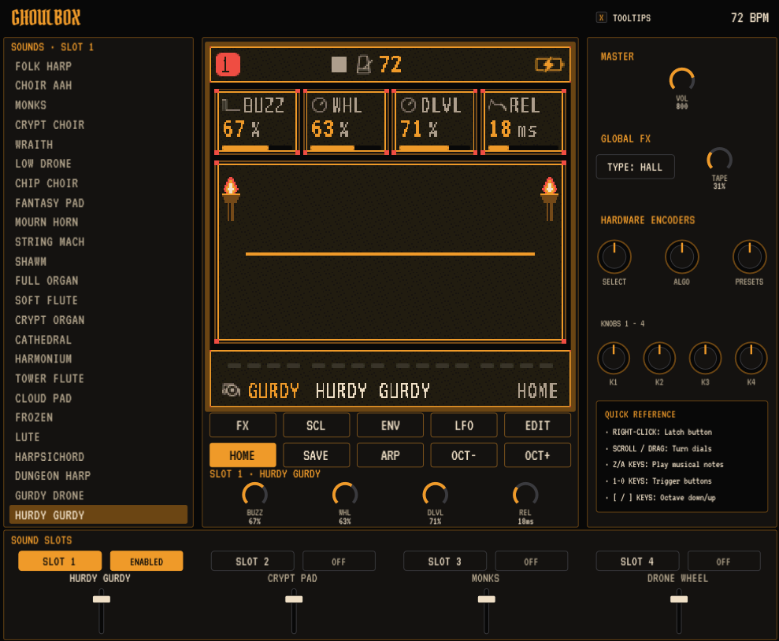

# GHOULBOX plugin

A dungeon-synth instrument for your DAW: crypt choirs, cathedral organs, hurdy-gurdies and cave drones, played from
a MIDI track. CLAP, VST3 and LV2 for Linux. GPL-3.0-only. Releases before 1.0 are pre-releases.

## Features

- **59 dark sounds across 13 engines.** Crypt pads and string machines; monk, crypt and glass choirs; cathedral,
  reed and pipe organs; lute, harpsichord and a dungeon harp; tower flutes, shawm, bagpipe and mournful brass; cave
  wind and torch crackle; and a bowed psaltery, a chamber organ, a recorder and a folk harp, sampled from real
  instruments.
- **A hurdy-gurdy engine.** GURDY bows a melody string over drones you tune, with the trompette's buzzing bridge
  struck in time. Six hurdy-gurdy sounds are ready to play.
- **Four layered sound slots.** Each note plays every enabled slot at once, so one keyboard plays a stack of up
  to four sounds: a choir over a drone over a harp. Each slot has its own on/off switch and volume fader.
- **A sound browser.** Every sound in one list: click a name to load it into the selected slot.
- **Atmosphere built in.** HALL reverb from a stone chamber to a 12-second cathedral, plus ROOM and SPRING; TAPE,
  a worn cassette with wow, flutter and hiss; CRSH bit and rate reduction; delay, chorus, flanger and distortion.
- **Medieval tunings and dungeon scales.** Play in Pythagorean, quarter-comma meantone or just intonation, and in
  Phrygian dominant, Hungarian minor or double harmonic among the scales.
- **Deep sound shaping.** Envelopes, LFOs, an arpeggiator, and a full editor down to the FM operators, on a
  pixel-art screen with flickering wall torches. Scroll or drag a knob to turn it; right-click a button to hold it.
- **Play from the computer keyboard.** Click the screen, then Z–/, S–' and Q–O play notes, 1–0 press the
  buttons, [ and ] shift the octave, and the arrow keys turn SELECT and ALGO.
- **Automation.** Master volume, each slot's on/off, level, pan, reverb and delay sends and its four sound
  knobs, the reverb type and TAPE are parameters your DAW can automate.
- **Made for the DAW.** It follows your project's tempo, saves its sounds and settings with your project, and
  stays silent until it gets MIDI. Sounds you SAVE go to a library shared by every GHOULBOX on your computer
  (`~/.local/share/GHOULBOX`).
- **Tooltips.** Hover anything for what it does; switch them off at the top of the window.

For 64-bit Linux (glibc 2.34 or newer, X11 or XWayland). Tested in REAPER. A beta: expect rough edges, and
[open an issue](https://github.com/jasonpersinger/ghoulbox-plugin/issues/new) if you find one.

## Install

Download the zip from [Releases](https://github.com/jasonpersinger/ghoulbox-plugin/releases), unpack it, and
run `./install.sh` in that folder. Rescan plugins in your DAW and insert **GHOULBOX (MESSYQUEST)**. The zip's
README has the details and the known issues (MIDI timing and latency).

## Building from source

### Pins
- `external/Felucca`: https://github.com/jasonpersinger/ghoulbox-fm1-dungeon-synth.git at tag `ghoulbox-v2.3.2` (71ac3f8). Never edited.
- `external/DPF`: https://github.com/DISTRHO/DPF.git at `main` 4238e1c (2025-10-23). DPF publishes no release tags.
- `external/DPF/dgl/src/pugl-upstream` (DPF's own submodule, for the window): https://github.com/DISTRHO/pugl.git at
  5e2621d, the commit DPF records.
- Fonts, compiled into the window: VT323 and Pirata One from `external/Felucca/assets/fonts/`, both under the SIL Open
  Font License (`external/Felucca/LICENSES/OFL-VT323.txt`, `OFL-PirataOne.txt`). The OFL asks that their licence
  travel with any distributed binary; the release zip ships both in `LICENSES/`.

### Build
    git submodule update --init external/Felucca external/DPF
    git -C external/DPF submodule update --init dgl/src/pugl-upstream
    make gen     # the firmware's generated headers (python3 tools/build.py --gen-only)
    make core    # build/libghoulbox_core.so
    make test
    make install # CLAP, VST3, LV2 into ~/.clap ~/.vst3 ~/.lv2
    make gui-snapshot   # by hand, with an X display: the window in a bare host, pictured into build/gui-snapshot.png
